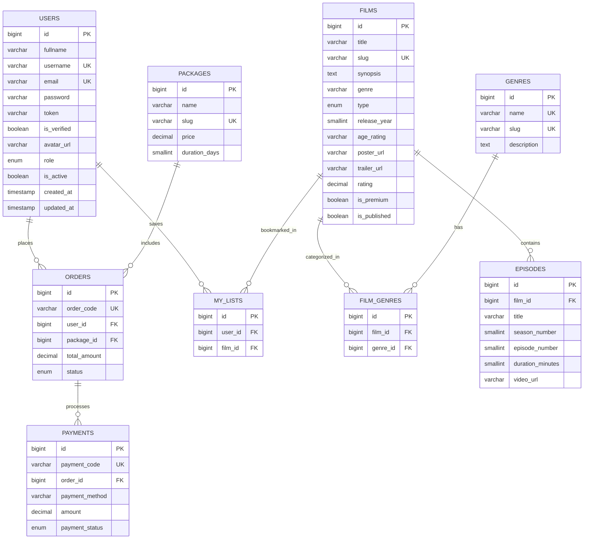

# Mission Advanced Backend B - Chill Movie App REST API

**Student:** Muhammad Burhanudin (20071)  
**Topik:** Node.js, Express.js, Authentication (`bcrypt` & `jsonwebtoken`), Auth Middleware, Query Params (`filter`, `sort`, `search`), Email Verification (`nodemailer` & `uuid`), dan Image Upload (`multer`).

Repository ini merupakan kelanjutan dari pengembangan backend aplikasi **Chill Movie App** (`chill_movie_db`). Pada misi ini, aplikasi dilengkapi dengan sistem autentikasi pengguna, proteksi endpoint menggunakan JWT Middleware, penyaringan/pengurutan/pencarian daftar film melalui Query Params, pengiriman email verifikasi akun menggunakan `nodemailer`, serta fitur unggah gambar menggunakan `multer`.

---

## Struktur Proyek

```text
mission-advanced-backendB/
├── database/
│   └── schema.sql                                        # Skema DDL (termasuk entitas users) & seed data
├── postman/
│   └── Chill_Movie_Advanced_API.postman_collection.json  # Koleksi Postman siap import untuk pengujian API
├── src/
│   ├── config/
│   │   └── database.js                                   # Konfigurasi koneksi pool MySQL
│   ├── controllers/
│   │   ├── authController.js                             # Controller Register, Login, & Verify Email
│   │   ├── movieController.js                            # Controller Movie & Query Params
│   │   └── uploadController.js                           # Controller Upload Gambar
│   ├── database/
│   │   └── init.js                                       # Skrip inisialisasi & migrasi otomatis database
│   ├── middlewares/
│   │   └── authMiddleware.js                             # Langkah 4: Middleware verifikasi JWT token
│   ├── routes/
│   │   ├── authRoutes.js                                 # Route /register, /login, /verify-email
│   │   ├── movieRoutes.js                                # Route /movie & /movies (dengan authMiddleware)
│   │   └── uploadRoutes.js                               # Route /upload
│   ├── services/
│   │   ├── authService.js                                # Service autentikasi token JWT
│   │   ├── emailService.js                               # Langkah 6: Service sendmail dengan Nodemailer
│   │   ├── movieService.js                               # Langkah 5: Service DML Movie (Filter, Sort, Search)
│   │   ├── uploadService.js                              # Langkah 7: Service konfigurasi Multer
│   │   └── userService.js                                # Langkah 2, 3, 6: Service Register, Login, Verify Email
│   └── app.js                                            # Konfigurasi Express.js
├── upload/                                               # Langkah 7: Folder penyimpanan file upload gambar
├── .env.example                                          # Contoh konfigurasi environment variabel
├── index.js                                              # Entry point server aplikasi
└── package.json
```

---

## Langkah Pertama: Menambahkan Entitas User ke dalam ERD & Database

Entitas **User** (`users`) dirancang untuk menyimpan informasi pengguna aplikasi beserta token verifikasi email:
- `fullname` (`VARCHAR(100)`)
- `username` (`VARCHAR(100)`, `UNIQUE`)
- `password` (`VARCHAR(255)` — dienkripsi dengan `bcrypt`)
- `email` (`VARCHAR(150)`, `UNIQUE`)
- `token` (`VARCHAR(255)` — menyimpan token unik hasil generate `uuid` untuk verifikasi email)
- `is_verified` (`BOOLEAN` — status verifikasi email pengguna)

### Entity Relationship Diagram (ERD)



---

## Langkah Kedua: Implementasi Register (`POST /register`)

Pada `src/services/userService.js` (`registerUser`):
1. Menerima payload `fullname`, `username`, `password`, dan `email`.
2. Melakukan enkripsi password menggunakan `bcrypt.hash(password, 10)`.
3. Menghasilkan token verifikasi unik menggunakan `uuid` (`uuidv4()`).
4. Menyimpan pengguna baru ke tabel `users` menggunakan perintah SQL `INSERT INTO users (fullname, username, email, password, token, is_verified) VALUES (?, ?, ?, ?, ?, ?)`.
5. Mengirimkan email verifikasi melalui fungsi `sendmail` (`nodemailer`).

---

## Langkah Ketiga: Implementasi Login (`POST /login`)

Pada `src/services/userService.js` (`loginUser`):
1. Memeriksa keberadaan pengguna berdasarkan `email` (`SELECT * FROM users WHERE email = ?`). Jika tidak ditemukan, mengembalikan status `401 Unauthorized` dengan pesan `"Email atau password yang dimasukkan salah."`.
2. Membandingkan password yang dimasukkan dengan hash di database menggunakan `bcrypt.compare(password, user.password)`. Jika tidak cocok, mengembalikan status `401 Unauthorized` dengan pesan `"Email atau password yang dimasukkan salah."`.
3. Jika sesuai, membuat token autentikasi menggunakan `jsonwebtoken` (`jwt.sign(...)`) dan mengembalikannya pada response (`200 OK`).

---

## Langkah Keempat: Implementasi Middleware (`authMiddleware.verifyToken`)

Pada `src/middlewares/authMiddleware.js`:
1. Memeriksa keberadaan token pada header `req.headers.authorization`.
2. Memverifikasi validitas token menggunakan `jwt.verify(token, JWT_SECRET)`.
3. Jika token tidak valid atau tidak ditemukan, mengembalikan status `401 Unauthorized`. Jika valid, meneruskan request menggunakan `next()`.
4. Dipasang pada route movie di `src/routes/movieRoutes.js`:
   ```js
   router.get('/movies', authMiddleware.verifyToken, movieController.getList);
   router.get('/movie', authMiddleware.verifyToken, movieController.getList);
   ```

---

## Langkah Kelima: Implementasi Query Params — Filter, Sort, & Search (`GET /movie`)

Pada `src/services/movieService.js` (`getAllMovies` / `getList`):
1. **Filtering (`WHERE`):** Menyaring data berdasarkan kategori `genre` (serta mendukung `type`, `release_year`, `age_rating`, `is_premium`).
2. **Sorting (`ORDER BY`):** Mengurutkan data berdasarkan field yang dikirimkan pada `sortBy` (contoh: `title`, `rating`, `release_year`, `genre`, `id`) dengan arah urutan `order=ASC` atau `order=DESC`.
3. **Searching (`WHERE ... LIKE`):** Mencari data movie berdasarkan karakter tertentu pada `title` atau `synopsis` menggunakan `LIKE %search%`.

Contoh URL:
```http
GET http://localhost:3001/movie?genre=Action&sortBy=rating&order=DESC&search=Spider
Authorization: Bearer <jwt_token>
```

---

## Langkah Keenam: Implementasi Send Email & Verifikasi Akun (`GET /verify-email`)

1. Menggunakan library `nodemailer` (`src/services/emailService.js`) dan `uuid` (`src/services/userService.js`).
2. Saat registrasi, token unik disimpan pada kolom `token` di tabel `users` dan dikirim ke email pengguna melalui fungsi `sendmail(email, token, fullname)`.
3. Endpoint `GET /verify-email?token=<token>` (juga mendukung `/verifikasi-email` dan pengiriman `token` via query params, route params, maupun body JSON):
   - Mencari token di database (`SELECT * FROM users WHERE token = ?`).
   - Jika tidak ditemukan, memberikan response `400 Bad Request`: `"Invalid Verification Token"`.
   - Jika ditemukan, memperbarui status `is_verified = TRUE` dan memberikan response `200 OK`: `"Email Verified Successfully"`.

---

## Langkah Ketujuh: Implementasi Upload Image (`POST /upload`)

1. Menggunakan library `multer` yang dikonfigurasi pada `src/services/uploadService.js`.
2. Menyimpan file gambar yang diunggah ke dalam folder `upload/` di bagian root aplikasi.
3. Endpoint `POST /upload` menerima payload `multipart/form-data` dengan key `file` dan mengembalikan informasi file beserta URL aksesnya.

---

## Tabel Referensi Endpoint

| Endpoint | Method | Keterangan | Payload | Params |
| :--- | :---: | :--- | :--- | :--- |
| `/register` | `POST` | Menambah user baru ke database & mengirim email verifikasi | `{ fullname, username, email, password }` | - |
| `/login` | `POST` | Melakukan login dengan email dan password | `{ email, password }` | - |
| `/verify-email` | `GET` | Melakukan verifikasi token yang dikirim melalui email | `{ token }` *(opsional)* | `?token=<uuid>` |
| `/movie` atau `/movies` | `GET` | Mendapatkan daftar movie berdasarkan query params (dilindungi JWT Middleware) | Header: `Authorization: Bearer <token>` | `?genre=Action&sortBy=rating&search=Batman` |
| `/upload` | `POST` | Melakukan upload gambar ke folder `/upload` | `multipart/form-data` (`file`) | - |

---

## Cara Menjalankan Proyek

1. **Instalasi Dependensi**
   ```bash
   npm install
   ```

2. **Konfigurasi Environment (`.env`)**
   Salin `.env.example` menjadi `.env` dan sesuaikan konfigurasi database MySQL serta SMTP (jika `SMTP_USER` dan `SMTP_PASS` dikosongkan, sistem otomatis menggunakan akun pengujian **Ethereal Email** dari `nodemailer` dan menampilkan *Preview URL* email di terminal & response API).

3. **Inisialisasi Database**
   ```bash
   npm run db:init
   ```

4. **Menjalankan Server**
   ```bash
   npm start
   # atau mode development:
   npm run dev
   ```
   Server berjalan di `http://localhost:3001`.
